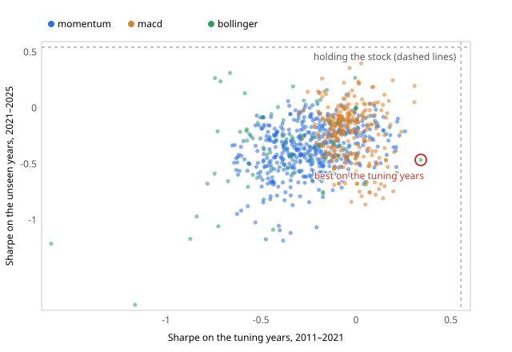

# Of 129 Nifty strategies, four survived honest testing, and all four were betting against collapsing stocks

_Draft 1, 4 Nov 2026. Not yet published. Every figure below comes from
`planning/research/nifty-funnel.json` and `nifty-grid.json`, and
`backend/scripts/reproduce_nifty.py` checks each one against them. The study's
rules were written down in `planning/RESEARCH-PLAN.md` before the first run._

The first write-up followed three strategies on one stock and watched the
checks disagree. This one asks the wider question: run the same three simple
strategies across India's fifty biggest companies for fifteen years, after
costs, tune them the way anyone would, and judge them on years the tuning
never saw. How many beat simply buying the stock and holding it?

Almost none. The few that did are more interesting than the many that didn't.

## The setup

Three strategies, the ones Finertia ships: momentum, MACD crossover and a
Bollinger-band mean-reverter, each with its small built-in parameter grid.
Daily prices from Yahoo, 1 Jan 2011 to 1 Jan 2026. A cost of 0.1% on every
trade, with the whole study re-run at half and at double that.

Each run is tuned on the first 70% of its history (to June 2021 for a stock
listed the whole time) and then scored on the rest, from August 2021 on. A
gap is cut between the two so no trade counts on both sides.

The bar was fixed in advance:

- **Beats buy-and-hold** means a higher Sharpe ratio than holding the stock,
  after costs.
- **Survives** means it beat buy-and-hold on the tuning years, stayed ahead on
  the unseen years, and passed three luck checks: a timing test against
  shuffled trades (p < 0.05), the Deflated Sharpe (probability above 0.95
  that the winner is better than the best of many lucky draws), and the
  probability of backtest overfitting (below 0.5).

## Which fifty?

Testing today's Nifty 50 back to 2011 tests the companies that did well
enough to be in it today. That flatters buy-and-hold, because the losers have
already been removed.

So the main run uses the index as it stood on 1 Jan 2011, rebuilt by undoing
every change to it since. Seven of those fifty have no history on Yahoo any
more, and they are named rather than dropped:

| Company | What happened |
|---|---|
| Cairn India | merged into Vedanta, April 2017 |
| HDFC | merged into HDFC Bank, July 2023 |
| IDFC | merged into IDFC First Bank, October 2024 |
| Jaiprakash Associates | in insolvency; Yahoo has no history |
| Ranbaxy Laboratories | merged into Sun Pharma, March 2015 |
| Reliance Capital | delisted after insolvency |
| Sterlite Industries | merged into Sesa Goa (now Vedanta), August 2013 |

That leaves 43 stocks, or 129 strategy-and-stock pairs. Most of the missing
seven were absorbed by other members, but Jaiprakash Associates and Reliance
Capital collapsed. Leaving them out flatters buy-and-hold a little even
here.

Today's list is run beside it, as the comparison, so the size of the bias is
a number and not just a caveat.

## The funnel

At the default cost, on the 2011 list:

| Step | Pairs left |
|---|---|
| Tested | 129 |
| Beat buy-and-hold on the tuning years | 50 |
| Still ahead on the unseen years | 7 |
| Passed all three luck checks | 4 |

Fifty of 129 looked better than holding the stock on the years they were
tuned on. Seven of them still were afterwards. The typical pair had a Sharpe
of 0.09 on its tuning years and −0.18 on the unseen ones, while buying and
holding the typical stock gave 0.59 over those same unseen years.

Costs move the edges but not the story. At half the cost the funnel ends on 4;
at double it ends on 3.

## The four survivors

| Stock | Strategy | Tuning-years Sharpe (hold) | Unseen-years Sharpe (hold) |
|---|---|---|---|
| Reliance Communications | momentum | 0.898 (−0.506) | 1.824 (−0.452) |
| Reliance Communications | MACD | 0.932 (−0.506) | 3.041 (−0.452) |
| Reliance Infrastructure | MACD | 1.268 (−0.390) | 0.445 (0.366) |
| Reliance Power | MACD | 1.621 (−0.462) | 0.955 (0.505) |

All four are on companies of the same group that fell apart over the decade.
Holding them lost money for years. A trend-following rule that stepped aside
when the price was falling did better than holding, not because it found
good moments to buy, but because it was out of the market for most of a long
decline.

That is a real effect, but it is not an edge most people are looking for. On
a stock that only goes down, any rule that is sometimes in cash beats one
that is always in.

Reliance Communications needs a second warning. Trading in it was suspended
for long stretches, and its price history has 295 days with no volume, where
the price simply repeats. A strategy cannot really trade on those days, and
its unseen-years Sharpe of 3.041 should not be read as anything a person
could have earned.

## Survivorship, measured

On today's list, the same funnel at the default cost reads 150 tested, 33
ahead on the tuning years, 4 still ahead afterwards, and 1 survivor
(Adani Enterprises, momentum).

The bias shows up where the plan said it would, in buy-and-hold. Holding the
typical stock on today's list gave a Sharpe of 0.51 over the tuning years,
against 0.28 on the 2011 list. Today's members are, by construction, the
ones that rose. That raises the bar a strategy has to clear, which is why
fewer pairs clear it: 33 of 150 against 50 of 129.

So survivorship bias does not only flatter strategies. Here it flattered the
benchmark, and it hid the collapsing stocks that produced three of the four
2011 survivors.

## One stock, 834 tries

The funnel uses the product's small grids: 16 momentum settings, 4 MACD and
12 Bollinger. A person tuning by hand tries far more. So the second half of
the study took one stock, chosen in advance as the most traded on the 2011
list, and tried 834 combinations, every one written down before the run.

The stock is Reliance Industries. On it, holding the shares gave a Sharpe of
0.553 over the tuning years and 0.544 over the unseen ones.

**None of the 834 beat holding the stock, on either the tuning years or the
unseen years.**

The best on the tuning years was Bollinger with a 40-day window and bands 3.0
wide, with a Sharpe of 0.342. On the unseen years it scored −0.463 and ranked
623rd of 834. The median combination scored −0.294 there.

The chart puts each combination at its tuning-years Sharpe (across) and its
unseen-years Sharpe (up). The two are only loosely related: the correlation
across all 834 is 0.32, so the right-hand edge of the cloud, where a person
tuning by hand would pick, is not where the best unseen results sit.

What each check said about the pick:

| Check | Reading | Verdict |
|---|---|---|
| Unseen years | −0.463, against holding's 0.544 | failed |
| Deflated Sharpe | 0.16, against a bar of 0.95 | failed |
| Whole-grid tests | no combination beats holding, in any of the three strategies | failed |
| Probability of overfitting | 0.34 for Bollinger's part of the grid | passed |
| Timing test | p = 0.046 | passed, just |

The two checks that passed are not a contradiction. The timing test asks
whether the pick's trades were better timed than the same trades shuffled,
not whether it beat holding the stock. The overfitting check asks whether
choosing the best on the tuning years beats choosing at random, and on this
grid it does, a little. Neither says the pick was worth trading, and the
three checks that compare it with holding the stock all say it was not.

The product's own small grid picked a different Bollinger setting on this
stock (window 50, width 2.5) with a tuning-years Sharpe of −0.086. Trying 834
settings instead of 12 raised the best tuning-years number from −0.086 to
0.342, and the unseen years took all of it back and more.

## What the checks themselves showed

Two things about the method came out of the run, and both are reported here
rather than fixed quietly.

- **The funnel's timing test ran on the default settings**, the way the
  product runs it, not on the setting the tuning picked. The 834-try half of
  the study tests the pick itself. A re-run of the funnel with the pick is
  planned.
- **The timing test gets easier to pass as costs rise.** On the 2011 list, 37
  pairs passed it at half cost, 60 at the default and 107 at double. Shuffling
  a strategy's trades breaks its long holding runs into many short ones, and
  each short one pays the cost again, so the shuffled versions are penalised
  more than the real one. That makes the test's bar fall as costs rise. It
  needs a version that shuffles whole holding runs instead of single days.

## What this is not

Not investment advice, and not a claim that no simple rule works on Indian
shares. It is three textbook strategies with small grids, on one fifteen-year
period with one split, on prices from Yahoo, which are not licensed for
commercial use. A null result is a result: across 129 honest tries, the only
strategies that beat holding the stock did it by avoiding stocks that were
falling apart.
